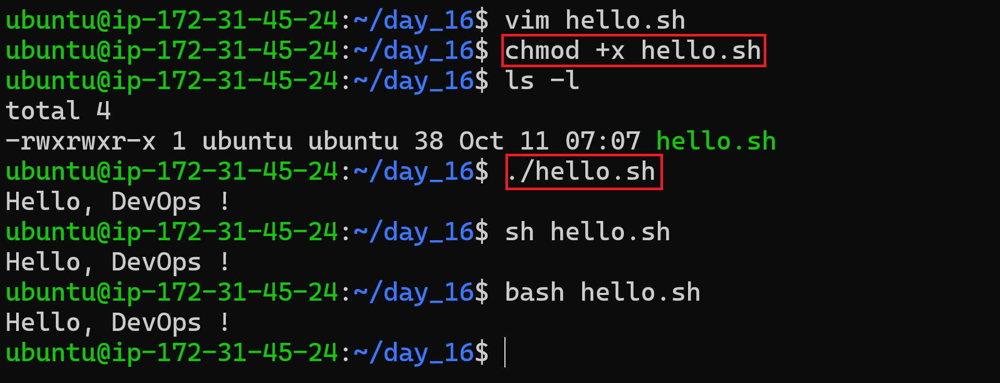
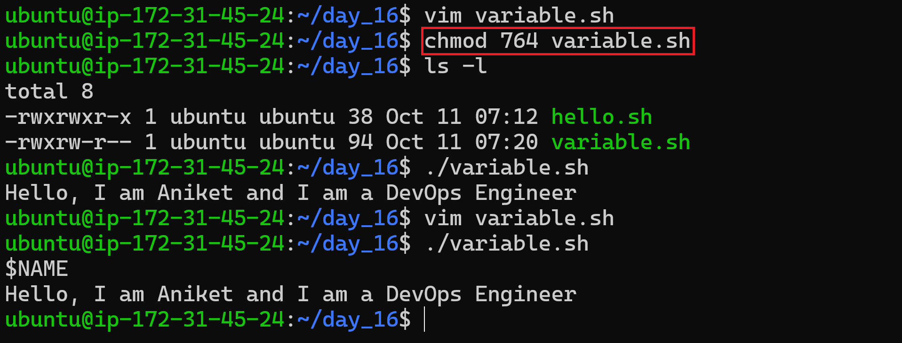
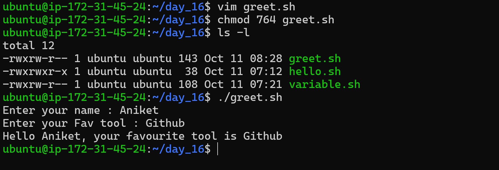
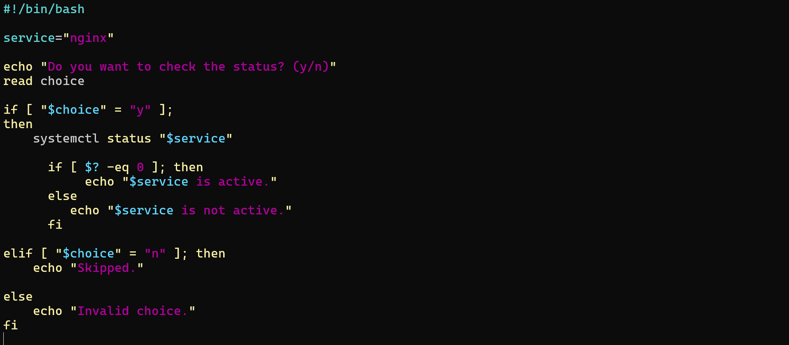
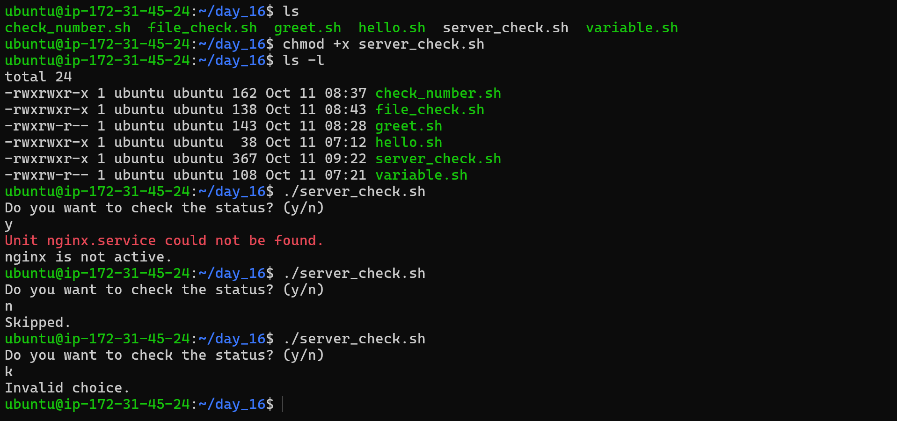

# Day 16 – Shell Scripting Basics

## Objective

Today I started learning Bash scripting fundamentals. I practiced creating simple scripts using variables, user input, conditional statements, file checks, and service status checks.

These are important building blocks for Linux automation and future DevOps workflows.

---

## Task 1 – Your First Script

### `hello.sh`

```bash
#!/bin/bash

echo "Hello, DevOps!"
```

### Make the script executable

```bash
chmod +x hello.sh
```

### Run the script

```bash
./hello.sh
```

### Output

```text
Hello, DevOps!
```

### What happens without a shebang?

- A script may still run when explicitly passed to Bash.
- When executed directly, the system may not know which interpreter should run it.
- Behavior can differ between shells.
- Using `#!/bin/bash` makes the intended interpreter clear.

**Screenshot – Task 1**



---

## Task 2 – Variables

### `variables.sh`

```bash
#!/bin/bash

NAME="Aniket"
ROLE="DevOps Engineer"

echo "Hello, I am $NAME and I am a $ROLE"
```

### Output

```text
Hello, I am Aniket and I am a DevOps Engineer
```

### Single quotes vs double quotes

```bash
NAME="Aniket"

echo '$NAME'
echo "$NAME"
```

### Output

```text
$NAME
Aniket
```

### What I learned

- Variables store values that can be reused in a script.
- Use `$NAME` to access a variable's value.
- Single quotes (`' '`) treat text literally.
- Double quotes (`" "`) allow variable expansion.
- Do not add spaces around `=` when assigning a variable.

**Screenshot – Task 2**



---

## Task 3 – User Input with `read`

### `greet.sh`

```bash
#!/bin/bash

read -r -p "Enter your name: " NAME
read -r -p "Enter your favourite tool: " TOOL

echo "Hello $NAME, your favourite tool is $TOOL"
```

### Sample output

```text
Enter your name: Aniket
Enter your favourite tool: Docker
Hello Aniket, your favourite tool is Docker
```

### What I learned

- `read` accepts input from the user.
- `-p` displays a prompt message.
- `-r` prevents backslashes from being interpreted specially.

**Screenshot – Task 3**



---

## Task 4 – Conditional Statements and File Checks

### A. Check whether a number is positive, negative, or zero

#### `check_number.sh`

```bash
#!/bin/bash

read -r -p "Enter a number: " NUM

if [[ ! "$NUM" =~ ^-?[0-9]+$ ]]; then
    echo "Please enter a valid integer."
elif [ "$NUM" -gt 0 ]; then
    echo "Positive Number"
elif [ "$NUM" -lt 0 ]; then
    echo "Negative Number"
else
    echo "Zero"
fi
```

### Sample output

```text
Enter a number: 5
Positive Number
```

### What I learned

- `if` checks a condition.
- `elif` checks another condition if the previous one is false.
- `else` runs when none of the earlier conditions match.
- `fi` closes the conditional block.

**Screenshot – Task 4A**


### B. Check whether a file exists

#### `file_check.sh`

```bash
#!/bin/bash

read -r -p "Enter the filename to search: " FILE

if [ -f "$FILE" ]; then
    echo "File exists."
else
    echo "File does not exist."
fi
```

### Sample output

```text
Enter the filename to search: hello.sh
File exists.
```

### What I learned

- `-f` checks whether a regular file exists.
- Quoting `"$FILE"` helps the script handle file paths containing spaces.
- `if-else` lets a script respond differently depending on the result.

**Screenshot – Task 4B**



---

## Task 5 – Combine It All: Linux Service Status Check

The goal is to ask the user whether they want to check a service. If they enter `y`, the script checks the service status. If they enter `n`, it prints `Skipped.`. Any other input is handled as invalid.

### `server_check.sh`

```bash
#!/bin/bash

service="nginx"

read -r -p "Do you want to check the status of $service? (y/n): " choice

if [[ "$choice" == "y" || "$choice" == "Y" ]]; then
    systemctl status "$service"
    status=$?

    if [ "$status" -eq 0 ]; then
        echo "$service status command completed successfully."
    else
        echo "$service is inactive, unavailable, or the status check failed."
    fi
elif [[ "$choice" == "n" || "$choice" == "N" ]]; then
    echo "Skipped."
else
    echo "Invalid input. Please enter y or n."
fi
```

### Make the script executable and run it

```bash
chmod +x server_check.sh
./server_check.sh
```

### Sample output

The exact output depends on the service and your Linux system.

```text
Do you want to check the status of nginx? (y/n): n
Skipped.
```

If you enter `y`, `systemctl status nginx` displays detailed service information. The script then checks the command's exit code.

### How it works

- `#!/bin/bash` — runs the script using Bash.
- `service="nginx"` — stores the service name in a variable.
- `read -r -p ... choice` — displays a prompt and takes input from the user.
- `if [[ "$choice" == "y" || "$choice" == "Y" ]]` — checks whether the user entered `y` or `Y`.
- `systemctl status "$service"` — displays detailed service information.
- `status=$?` — stores the exit code of the last command. `0` means the command succeeded; a nonzero value means it returned an error.
- `elif` — handles the user's `n` or `N` response.
- `else` — handles invalid input.

**Important:** A successful `systemctl status` command does not always mean the service is currently active. For a direct active-state check, use `systemctl is-active --quiet "$service"`.

**Screenshot – Task 5**



---

## Common Commands

| Command | Purpose |
|---|---|
| `nano script.sh` | Create or edit a script |
| `chmod +x script.sh` | Make a script executable |
| `./script.sh` | Run a script from the current directory |
| `echo` | Print text |
| `read -r` | Accept user input |
| `if`, `elif`, `else`, `fi` | Make decisions based on conditions |
| `[ -f "$FILE" ]` | Check whether a regular file exists |
| `systemctl status nginx` | Display detailed service status |
| `$?` | Read the previous command's exit code |

---

## Key Learnings

1. **Shebang:** `#!/bin/bash` specifies the interpreter used to execute the script.
2. **Variables and input:** Variables store values, and `read` makes scripts interactive.
3. **Conditional logic:** `if`, `elif`, and `else` allow scripts to make decisions.
4. **File checks:** `-f` can test whether a regular file exists.
5. **Service checks:** `systemctl` helps inspect Linux services.
6. **Exit codes:** `$?` provides the exit status of the last command.

.

## Day 16 Completed ✅


