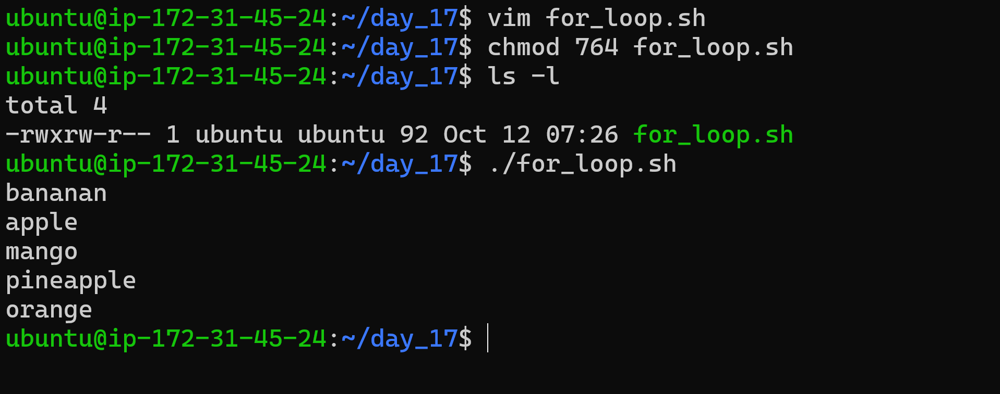
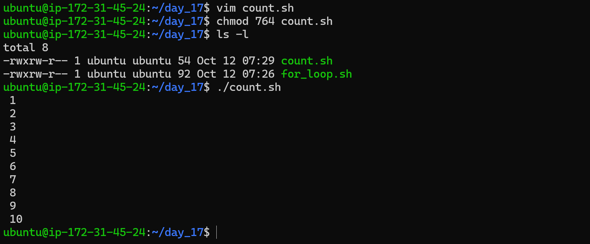
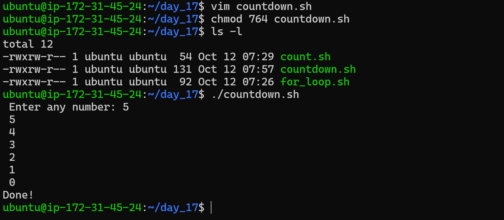
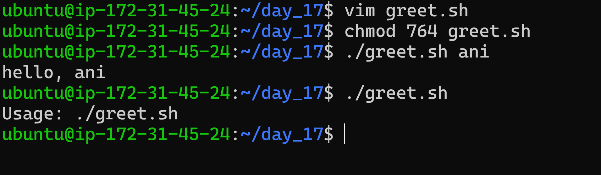
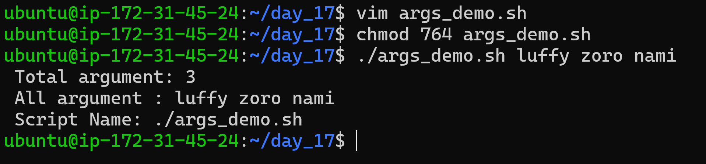
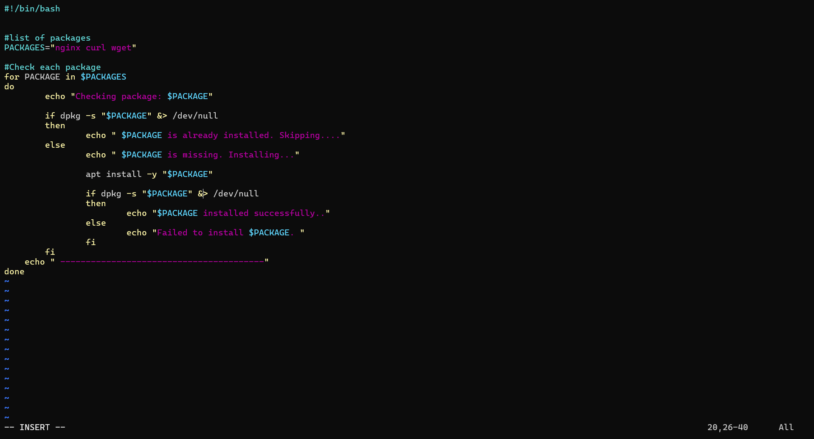
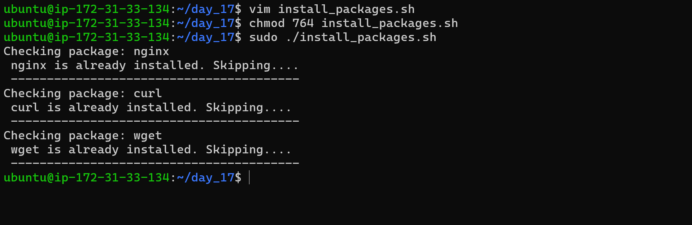
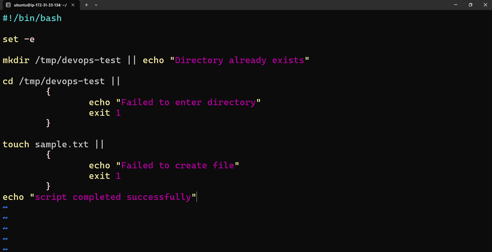
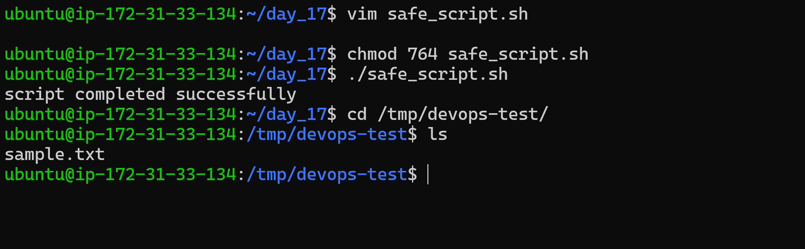

# Day 17 — Shell Scripting: Loops, Arguments & Error Handling

> **Goal:** Practice Bash scripting techniques that make repetitive Linux administration tasks easier to automate, validate, and troubleshoot.

## Overview

Today I practiced:

- `for` and `while` loops
- User input and command-line arguments
- Package installation checks and root-privilege validation
- Basic error handling with exit statuses, `||`, and `set -e`

## Tasks Completed

### 1. `for` Loops

Created `for_loop.sh` to print a list of fruits and `count.sh` to print numbers from 1 to 10.

**What I practiced:** Iterating over a list, repeating commands, and using basic Bash loop syntax.





### 2. `while` Loop

Created `countdown.sh` to accept a number from the user, count down to `0`, and then print `Done!`.

**What I practiced:** Reading input with `read`, checking a condition, and updating a variable with arithmetic expansion.



### 3. Command-Line Arguments

Created `greet.sh` to accept a name and `args_demo.sh` to display information about arguments passed to a script.

| Parameter | Meaning |
|---|---|
| `$0` | Script name |
| `$1` | First argument |
| `$#` | Number of arguments |
| `"$@"` | All arguments, preserved as separate values when quoted |

I tested the greeting script with and without a name to practice basic input validation.





### 4. Package Installation Automation

Created `install_packages.sh` to check for `nginx`, `curl`, and `wget`, and install packages that are missing. The script also checks for root privileges before performing administrative tasks.

Run it on Ubuntu/Debian with:

```bash
chmod +x install_packages.sh
sudo ./install_packages.sh
```

**What I practiced:** Checking package status with `dpkg`, processing multiple packages in a loop, and validating permissions before making system changes.

#### Understand the Logic

| Command | Purpose |
|---|---|
| `PACKAGES="nginx curl wget"` | Stores the package names in a variable |
| `for PACKAGE in $PACKAGES` | Loops through each package name |
| `dpkg -s "$PACKAGE"` | Checks whether the package is installed |
| `&> /dev/null` | Redirects standard output and standard error so they are not displayed |
| `if ... else` | Chooses whether to skip or install the package |
| `apt install -y "$PACKAGE"` | Installs the missing package and automatically answers yes to prompts |





### 5. Basic Error Handling

Created `safe_script.sh` to create a working directory, enter it, and create a file. The script prints useful messages when an operation fails.

Concepts practiced:

- `set -e` — exits when an unhandled command failure occurs
- `||` — runs a fallback command when the preceding command fails
- `exit 1` — returns a non-zero status to indicate failure
- Checking directory and file operations instead of assuming they succeeded





## Commands Practiced

```bash
chmod +x *.sh

./for_loop.sh
./count.sh
./countdown.sh
./greet.sh Aniket
./args_demo.sh Linux AWS Docker
sudo ./install_packages.sh
./safe_script.sh
```

## Key Learnings

1. **Loops** reduce repeated commands and make scripts easier to maintain.
2. **Command-line arguments** make scripts reusable with different inputs.
3. **Validation** helps scripts respond clearly when required input or permissions are missing.
4. **Error handling** makes automation easier to troubleshoot and more reliable.
5. **Package checks** help avoid reinstalling software that is already present.

## Conclusion

Day 17 was a hands-on step toward automating everyday Linux administration with Bash. I practiced loops, arguments, package checks, and basic error handling—building blocks for writing more dependable DevOps scripts.

**Day 17 completed ✅**

#90DaysOfDevOps #DevOps #Linux #Bash #ShellScripting #Automation #AWS #CloudComputing
