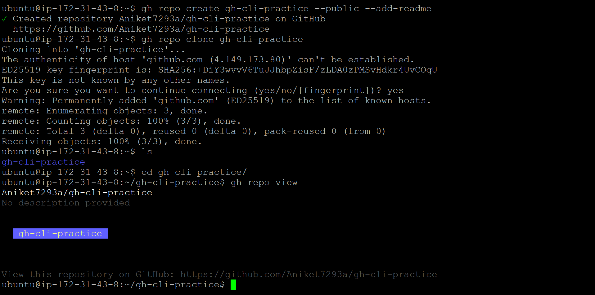
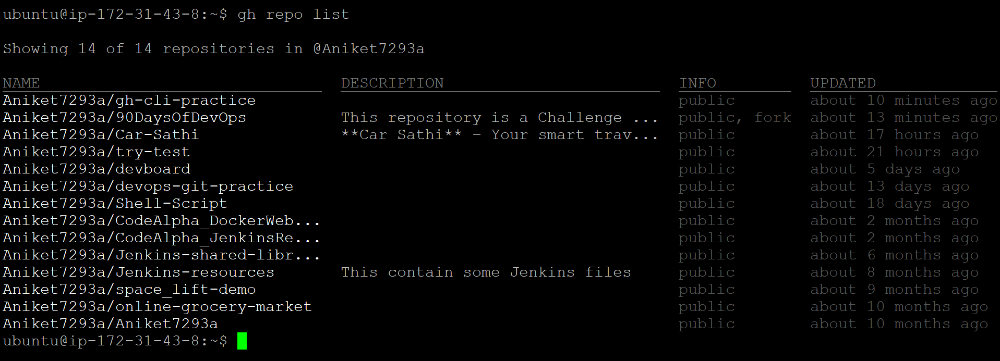
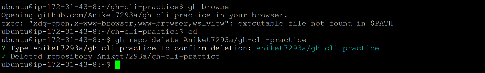
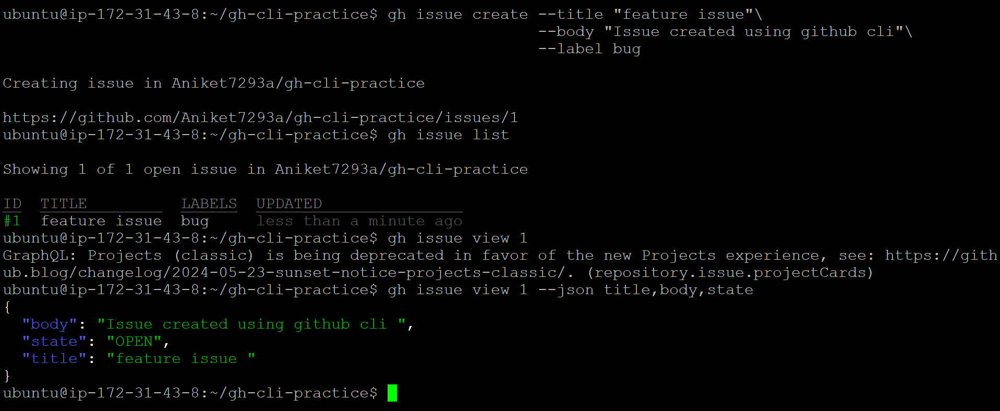
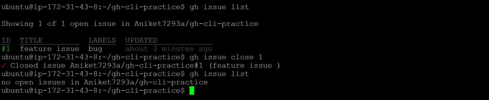
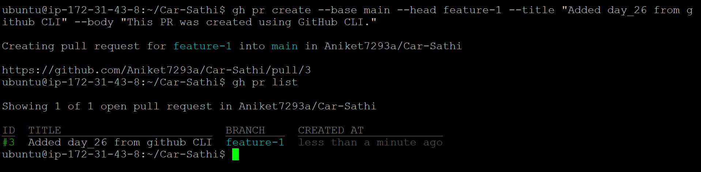
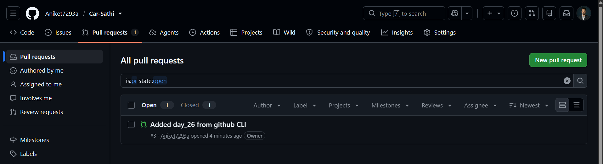
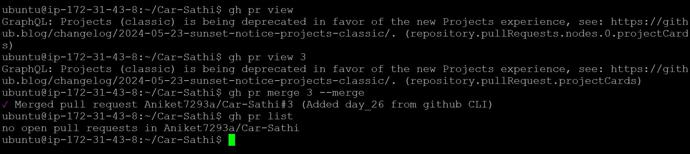
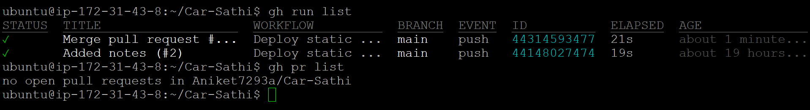
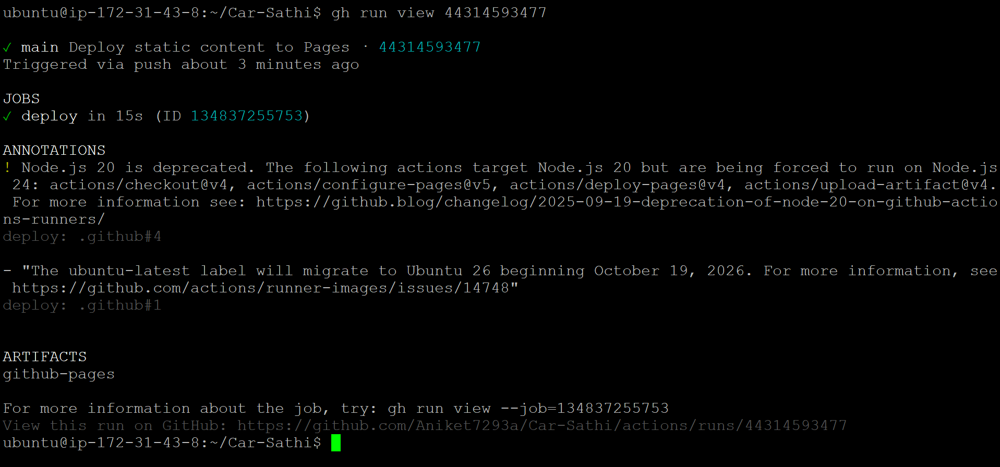

# Day 26 -- GitHub CLI: Manage GitHub from Your Terminal

## 📌 Overview

Today I explored **GitHub CLI (`gh`)**, a powerful command-line tool
that allows developers and DevOps engineers to interact with GitHub
directly from the terminal.

Instead of switching between the terminal and browser, I learned how to
manage repositories, issues, pull requests, GitHub Actions workflows,
and releases using simple CLI commands.

------------------------------------------------------------------------

# Task 1: Install and Authenticate

### 1. Update Package Lists

``` bash
sudo apt update
```

Updates the Ubuntu package index to fetch the latest available package
information.

### 2. Install GitHub CLI

``` bash
sudo apt install gh -y
```

Installs GitHub CLI on the Ubuntu system.

### 3. Verify Installation

``` bash
gh --version
```

Displays the installed GitHub CLI version.

### 4. Authenticate with GitHub

``` bash
gh auth login
```

Starts the authentication process and connects the terminal to a GitHub
account.

During authentication, GitHub CLI provides options such as browser-based
login and token-based authentication.

### 5. Check Authentication Status

``` bash
gh auth status
```

Displays the authenticated GitHub account and the current authentication
status.

### Authentication Methods Supported by `gh`

-   Browser-based OAuth login
-   Personal Access Token (PAT)
-   Environment variables such as `GH_TOKEN` and `GITHUB_TOKEN`
-   GitHub Enterprise authentication

### 📸 Proof

> 

------------------------------------------------------------------------

# Task 2: Working with Repositories

### 1. Create a Public Repository

```
gh repo create gh-cli-practice --public --add-readme
```

Creates a new public repository named `day26-gh-test`, initializes it
with a README, and clones it locally.


### 2. Clone an Existing Repository

``` bash
gh repo clone octocat/Hello-World
```

Clones the specified GitHub repository to the local machine.

### 3. View Repository Details

``` bash
gh repo view
```

Displays details of the current repository, including its description
and other available information.


### 📸 Proof

> 


### 4. List Repositories

``` bash
gh repo list
```

Lists repositories belonging to the authenticated GitHub account.

### 📸 Proof

> 

### 5. Open Repository in Browser

``` bash
gh repo view --web
```

Opens the current repository directly in the default web browser.

### 6. Delete a Repository

``` bash
gh repo delete day26-gh-test --yes
```

Deletes the specified repository without asking for an additional
confirmation.

**Important:** Repository deletion is permanent and requires the
appropriate authorization.

### Additional Learning: OAuth Scopes

While exploring repository deletion, I learned that deleting
repositories requires the `delete_repo` OAuth scope when using
OAuth-based authentication.

Without the required permission, GitHub may return an HTTP 403 error.

### 📸 Proof

> 

------------------------------------------------------------------------

# Task 3: Working with GitHub Issues

### 1. Create an Issue

``` bash
gh issue create \
  --title "Day 26 GitHub CLI Practice" \
  --body "Testing GitHub CLI issue management." \
  --label bug
```

Creates a new issue with a title, description, and bug label.

### 2. List Open Issues

``` bash
gh issue list
```

Displays all currently open issues in the repository.

### 3. View a Specific Issue

``` bash
gh issue view 1 --json title,body,state
```

Displays selected information about issue number `1`, including its
title, description, and current state.

### 📸 Proof

> 

### 4. Close an Issue

``` bash
gh issue close 1
```

Closes issue number `1` directly from the terminal.

### 📸 Proof

> 

### How can `gh issue` be used in automation?

GitHub CLI can automate issue management in DevOps workflows.

Examples:

-   Automatically create issues when monitoring scripts detect failures.
-   Open incident issues when CI/CD pipelines fail.
-   Generate issues based on application log analysis.
-   Close issues automatically after a problem is resolved.

### Additional Learning: GitHub Projects Classic Warning

During issue inspection, I encountered a warning related to deprecated
GitHub Projects (Classic) metadata.

Using:

``` bash
gh issue view 1 --json title,body,state
```

allowed me to retrieve the required issue information without requesting
the deprecated project metadata.

------------------------------------------------------------------------

# Task 4: Working with Pull Requests

### 1. Create a New Branch

``` bash
git checkout -b day26-gh-cli
```

Creates a new branch named `day26-gh-cli` and switches to it.

### 2. Make Changes

``` bash
echo "Day 26 GitHub CLI Practice" > day26.txt
```

Creates a new file containing sample content for pull request practice.

### 3. Stage Changes

``` bash
git add day26.txt
```

Adds the new file to the Git staging area.

### 4. Commit Changes

``` bash
git commit -m "Add Day 26 GitHub CLI practice file"
```

Creates a commit containing the staged changes.

### 5. Push the Branch

``` bash
git push -u origin day26-gh-cli
```

Pushes the branch to the remote GitHub repository and sets its upstream
tracking branch.

### 6. Create a Pull Request

``` bash
gh pr create --fill
```

Creates a pull request using information from the branch and its
commits.

### 7. List Open Pull Requests

``` bash
gh pr list
```

Displays all currently open pull requests in the repository.

### 📸 Proof

> 

### 8. View Pull Request Details

``` bash
gh pr view
```

Displays details of the current pull request, including its title,
description, status, and review information.

### 9. Check Pull Request Status and Checks

``` bash
gh pr checks
```

Displays the CI/CD status checks associated with the current pull
request.

### 10. View Pull Request Changes

``` bash
gh pr diff
```

Displays the code differences introduced by the pull request.

### 📸 Proof

> 

### 11. Merge Pull Request

``` bash
gh pr merge --squash
```

Merges the pull request using the squash merge method.

### 📸 Proof

> 

### Merge Methods Supported by `gh pr merge`

**1. Merge Commit**

``` bash
gh pr merge --merge
```

Combines the pull request changes using a merge commit, preserving the
individual commits.

**2. Squash Merge**

``` bash
gh pr merge --squash
```

Combines all pull request commits into a single commit before merging.

**3. Rebase Merge**

``` bash
gh pr merge --rebase
```

Replays the pull request commits on top of the base branch without
creating a merge commit.

### Reviewing Someone Else's Pull Request

**View Pull Request**

``` bash
gh pr view <PR_NUMBER>
```

Displays details of another contributor's pull request.

**Checkout Pull Request Locally**

``` bash
gh pr checkout <PR_NUMBER>
```

Downloads the pull request branch and checks it out locally for testing
and review.

**Approve Pull Request**

``` bash
gh pr review <PR_NUMBER> --approve
```

Approves the pull request.

**Request Changes**

``` bash
gh pr review <PR_NUMBER> --request-changes --body "Please fix the issue."
```

Requests modifications before the pull request can be approved.

**Add Review Comments**

``` bash
gh pr review <PR_NUMBER> --comment --body "Looks good."
```

Adds a review comment without approving or requesting changes.

------------------------------------------------------------------------

# Task 5: GitHub Actions and Workflows

### 1. List Workflow Runs

``` bash
gh run list
```

Displays recent GitHub Actions workflow executions for the current
repository.

### 📸 Proof

> 

### 2. View a Specific Workflow Run

``` bash
gh run view <RUN_ID>
```

Displays detailed information about a particular workflow execution.

### 📸 Proof

> 

### 3. Watch Workflow Execution

``` bash
gh run watch <RUN_ID>
```

Continuously monitors a workflow run and displays its execution status
until completion.

### 4. View Failed Workflow Logs

``` bash
gh run view <RUN_ID> --log-failed
```

Displays logs from failed jobs and steps to help troubleshoot workflow
errors.

### 5. List Available Workflows

``` bash
gh workflow list
```

Lists all GitHub Actions workflows configured in the repository.

### 6. View a Specific Workflow

``` bash
gh workflow view <WORKFLOW_NAME>
```

Displays information about a specific GitHub Actions workflow.

### How are `gh run` and `gh workflow` useful in CI/CD?

These commands help DevOps engineers:

-   Monitor CI/CD pipeline execution.
-   Identify and troubleshoot failed deployments.
-   Inspect workflow execution logs.
-   Trigger and manage GitHub Actions workflows.
-   Integrate pipeline monitoring into automation scripts.

------------------------------------------------------------------------

# Task 6: Useful GitHub CLI Commands

### 1. Interact with GitHub API

``` bash
gh api user
```

Fetches information about the currently authenticated GitHub user using
the GitHub API.

### 2. Work with GitHub Gists

**List Gists**

``` bash
gh gist list
```

Lists Gists available for the authenticated account.

**Create a Gist**

``` bash
gh gist create notes.txt
```

Creates a new GitHub Gist from the local `notes.txt` file.

### 3. Work with GitHub Releases

**List Releases**

``` bash
gh release list
```

Displays available releases in the current repository.

**Create a Release**

``` bash
gh release create v1.0.0
```

Creates a new GitHub release using the specified tag. The tag must exist
or be created as part of the release process.

### 4. Create GitHub CLI Aliases

**List Existing Aliases**

``` bash
gh alias list
```

Displays all configured custom GitHub CLI aliases.

**Create an Alias**

``` bash
gh alias set prs "pr list"
```

Creates a shortcut named `prs` for the `gh pr list` command.

**Use the Alias**

``` bash
gh prs
```

Runs the pull request listing command using the custom alias.

### 5. Search GitHub Repositories

``` bash
gh search repos devops
```

Searches GitHub for repositories related to DevOps.

------------------------------------------------------------------------

# 📚 Key Takeaways

-   Learned how to install and authenticate GitHub CLI on Ubuntu.
-   Created, cloned, viewed, listed, and deleted GitHub repositories.
-   Managed GitHub issues directly from the terminal.
-   Created and merged pull requests using GitHub CLI.
-   Explored different pull request merge strategies.
-   Learned how to review other contributors' pull requests.
-   Monitored GitHub Actions workflow executions.
-   Explored useful commands such as `gh api`, `gh gist`, `gh release`,
    `gh alias`, and `gh search`.
-   Understood how GitHub CLI can simplify DevOps automation and CI/CD
    operations.

------------------------------------------------------------------------

## ✅ Day 26 Completed

Today I learned that GitHub CLI makes GitHub management much easier by
bringing repository operations, issue tracking, pull request management,
and CI/CD monitoring directly into the terminal.

It reduces context switching between the browser and terminal and
provides a powerful way to automate everyday GitHub operations.

**One step closer to becoming a better DevOps Engineer!** 🚀

#90DaysOfDevOps #DevOpsKaJosh #TrainWithShubham
