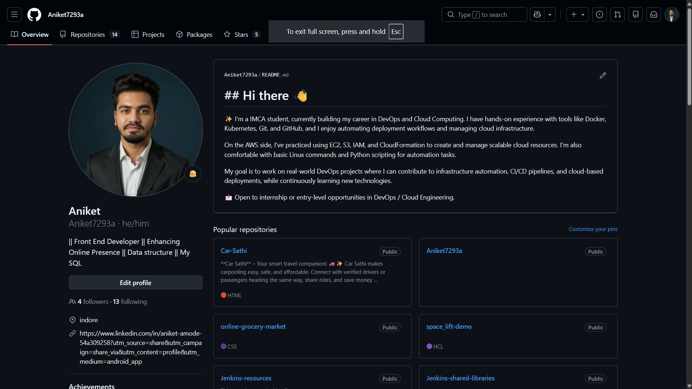
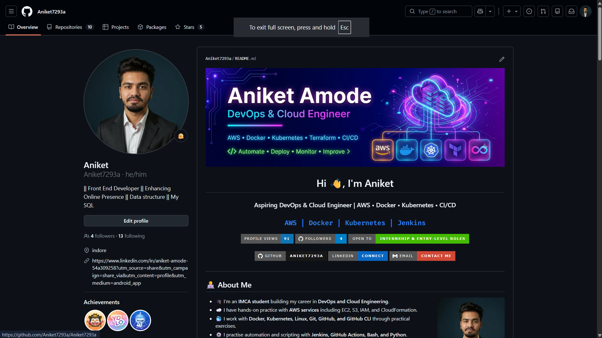

# Day 27 – GitHub Profile Makeover: Build Your Developer Identity

## 📌 Overview

Day 27 was focused on improving my **GitHub profile as a professional developer portfolio**.

The goal was to make my GitHub profile cleaner, easier to understand, and more useful for recruiters, hiring managers, and other developers.

Today I worked on:

- Auditing my existing GitHub profile
- updating my GitHub profile professionally and README
- Organizing repositories
- Improving repository names, descriptions, and documentation
- Pinning my strongest projects
- Cleaning up unnecessary repositories
- Comparing my profile before and after the makeover

---

## ✅ Task 1: Audit Your Current GitHub Profile
Before making changes, assess where you stand:
1. Visit your own GitHub profile as if you were a stranger — what impression does it give?
2. Answer in your notes:

   ```bash
   - Is your profile picture professional?
    - **Yes**
   
   - Is your bio filled in? Does it say what you do?
    - **Yes**
   
   - Are your pinned repos relevant, or are they random forks?
   - **Relevant**
   
   - Do your repos have descriptions, or are they blank?
   - **Yes they have good amount of  descriptions**
   
   - Would a recruiter understand what you've been working on?
   - **Yes**
   ```
---
## ✅ Task 2 – Create My GitHub Profile README

Created my special GitHub profile repository:

```text
Aniket7293a/Aniket7293a
```

### Profile README Includes
- Professional introduction and banner
- DevOps & Cloud technology stack
- Featured projects
- 90DaysOfDevOps journey
- GitHub statistics and contribution graph
- Automated contribution snake animation
- Contact information and career goals

### Technologies Highlighted
`AWS` `Docker` `Kubernetes` `Terraform` `Jenkins` `GitHub Actions` `Linux` `Python` `Git` `Bash` `MySQL`

### Repository
https://github.com/Aniket7293a/Aniket7293a


## Task 3: Organize Your Repositories

1. **90 Days of DevOps** — 
    
    * [90 Days of DevOps Repository](https://github.com/Aniket7293a/90DaysOfDevOps)

2. **Shell Scripts** — a dedicated repo for all your shell scripting work

    * [Shell Scripts Repository](https://github.com/Aniket7293a/shell-scripts)

3. **DevOps Notes** — a repo for your learning notes, cheat sheets, and references

    * [DevOps Notes](https://github.com/Aniket7293a/devops-notes)

---
## Task 4: Pin Your Best Repos

* **Pinned my best selected repos. **

---

## ✅ Task 5 – GitHub Cleanup

I reviewed my GitHub repositories and cleaned up unnecessary content.

### Actions Taken

- Removed or archived unnecessary repositories.
- Improved unclear repository names.
- Added descriptions to important repositories.
- Improved README documentation.
- Checked repository organization.
- Reviewed repositories for accidentally committed sensitive files.

### Security Checks

I made sure that the following should never be pushed to public repositories:

```text
.env
*.pem
*.key
AWS access keys
API keys
Database passwords
Docker Hub passwords
Terraform secret variables
Github personal access token 
```

A typical `.gitignore` should contain:

```gitignore
.env
*.pem
*.key
terraform.tfstate
terraform.tfstate.*
.terraform/
node_modules/
venv/
__pycache__/
```

---
## Task 6: Before & After

- Before


    
- After



--- 

## 🚀 Three Major Improvements

### 1. Stronger Personal Branding
Updated my GitHub profile to highlight my focus on **DevOps & Cloud Engineering**, including my technical skills, learning journey, and career goals.

### 2. Better Project Visibility
Organised and pinned my important repositories to make my hands-on projects, automation scripts, and DevOps practice easier to discover.

### 3. Improved Documentation
Updated repository descriptions, README files, and documentation to make my work more organised and easier to understand.

Good documentation helps visitors understand:
- Project purpose and functionality
- Technologies and tools used
- Setup and execution steps
- Key learnings and practical implementation

---
